# Acorn Atom Emulator for ESP32-S3 8048S070 and CYD

I bought my first Acorn Atom in 1980 and immediately loved the way you
could program it both in basic and machine code. It was surprising what
you could do with it despite its small memory and 1MHz clock speed. In
the era of the PC i really missed the enjoyment of programming. That
returned with the ESP32 and Arduino code and so...... I developed a
practical **Acorn Atom emulator for the ESP32-S3 8048S070 7-inch
800×480 board**. The project is now focused on this platform, including
its RGB display, SD storage, I2S audio and optional physical Atom keyboard.

The emulator runs the **original Acorn Atom 6502 ROM code and original
Atom software**. BASIC, the Kernel, cassette routines, utility ROMs,
AtoMMC2 and games execute as real 6502 instructions inside the emulator;
they are not rewritten as ESP32 applications.

The current version is **V191**, the stable development baseline.

------------------------------------------------------------------------

<table>
<tr>
<td align="center" width="50%">
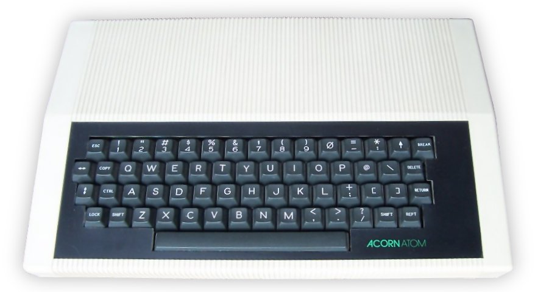<br>
<strong>Original Acorn Atom</strong>
</td>
<td align="center" width="50%">
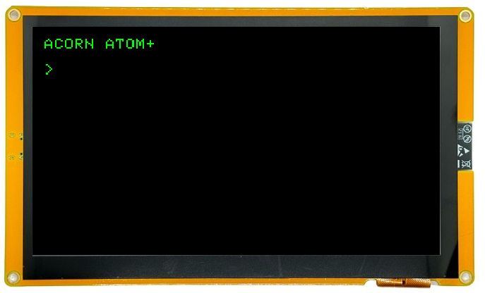<br>
<strong>Acorn Atom emulator on the ESP32-S3 8048S070</strong>
</td>
</tr>
</table>

## Highlights

-   Original Acorn Atom BASIC, Floating Point and Kernel ROM execution
-   **Fake6502 v1.1** MOS 6502 emulation core by Mike Chambers is used
-   Atom-compatible 64 KB address space and I/O map
-   CPU speed regulation to reproduce the Atom's nominal **1 MHz**
    execution rate even though the ESP32 can execute the emulator faster
-   8255 PPI emulation
-   MC6847 video emulation
-   Atom text, semigraphics, monochrome graphics and colour graphics
-   Original Atom keyboard-matrix behaviour
-   Normal ROM keyboard input via serial, raw matrix-scanning programs
    and direct `FE71` keyboard users
-   SHIFT, CTRL, ESC and BREAK handling
-   Physical MCP23017 Atom keyboard on GPIO19/20 with fast software-I2C scanning
-   SHIFT+BREAK boots the integrated BBC BASIC environment
-   Dedicated 3D-printable housing for the reproduction Atom keyboard
-   Supports SD-card `.atm` cassette images
-   `LOAD` and `SAVE` preserve the Atom-visible cassette semantics but
    speeds it up greatly
-   SD-backed directories and automatic `.atm` mounting
-   **AtoMMC2 / ATMMC3E ROM at `$E000-$EFFF`**
-   AtoMMC2 SD filesystem with read/write support
-   Eight switchable **`$A000-$AFFF` utility-ROM banks**
-   **Resident ASBK-S Schakelsoft V24** loaded from SPIFFS into Atom RAM
-   Automatic Schakelsoft initialization after every Atom RESET
-   Circular utility-ROM command search, so banked ROM commands can be
    used in any order
-   8048S070 audio through the onboard **MAX98357 I2S amplifier**
-   BMP screenshots to SD card with `~shot` or from AUX1 keypress
-   Correct Atom BASIC `RND` cold-start behaviour

------------------------------------------------------------------------

## ESP32-S3 8048S070 hardware

The current emulator targets the **ESP32-S3 8048S070** with its 7-inch
800×480 RGB display. Display handling uses **LovyanGFX**. The board also
provides SD storage and the MAX98357 I2S audio interface used by the
emulator.

Current connections are:

  Function              GPIO
  ------------------- ------
  SD SCK                  12
  SD MISO                 13
  SD MOSI                 11
  SD CS                   10
  MAX98357 BCLK            0
  MAX98357 WS/LRCLK       18
  MAX98357 DATA           17
  Keyboard MCP23017 SDA   19
  Keyboard MCP23017 SCL   20

The physical keyboard uses **software I2C**, not Arduino `Wire`. Earlier
hardware-I2C experiments caused stability problems on this board.
The slow per-bit Arduino `pinMode()` switching was replaced with direct ESP32-S3 GPIO
output-enable register control while preserving the proven electrical behaviour:
LOW is actively driven and HIGH is a true released/high-impedance line with the
pull-up. This increased the measured complete keyboard scan rate from about 16
to roughly 76 scans per second without the stability regression seen in an
earlier permanent `OUTPUT_OPEN_DRAIN` experiment.
------------------------------------------------------------------------

## What is being emulated?

This is not a collection of ESP32 ports of Atom games.
The ESP32 supplies the emulated hardware while the original software
executes on the emulated 6502.

``` text
                    ESP32-S3 8048S070
                           |
                       Fake6502
                       6502 core
                           |
              +------------+------------+
              |                         |
          Atom ROMs                  Atom RAM
              |                    + video RAM
              +------------+------------+
                           |
                      Atom I/O map
                           |
          +----------------+----------------+
          |                |                |
        8255           cassette          AtoMMC2
          |
    +-----+------+-------------+
    |            |             |
 keyboard      MC6847          PC2
  matrix        video          audio
    |            |             |
 terminal     TFT/RGB      PWM or I2S
```

When a game accesses `$B000-$B003`, scans the keyboard, changes video
mode, toggles PC2 or calls a Kernel routine, it is the **original 6502
code** performing those operations.

------------------------------------------------------------------------

## CPU emulation and 1 MHz speed regulation

The MOS 6502 execution engine is **Fake6502 v1.1 by Mike Chambers**.
Modern ESP32 hardware can emulate the Atom faster than the real machine.
This is particularly noticeable on the ESP32-S3: without regulation, the
emulated CPU can exceed the Atom's original clock rate. The emulator
therefore uses a **real-time speed regulator**. It measures emulated
6502 cycles against elapsed real time and throttles execution when
necessary so that software sees approximately: 1,000,000 6502 cycles per
second

This is important because many Atom programs assume a 1 MHz processor
for:
-   software timing loops
-   games
-   keyboard scanning
-   sound generation
-   cassette timing
-   animation speed

The regulator does not modify the 6502 program or individual
instructions. The CPU core can run as quickly as the ESP32 permits
internally, but the emulator prevents it from advancing the Atom's
simulated time faster than the real **1 MHz machine**.
Diagnostic output can report the measured effective CPU rate, typically
close to: \[CPU\] ... = 1.000 MHz

------------------------------------------------------------------------

## Original Atom ROMs

The normal system ROMs are loaded from SPIFFS:

  ROM                        Address
  -------------------------- ---------------
  `Atom_Basic.rom`           `$C000-$CFFF`
  `Atom_FloatingPoint.rom`   `$D000-$DFFF`
  `ATMMC3E.rom`              `$E000-$EFFF`
  `Atom_Kernel.rom`          `$F000-$FFFF`

Each ROM image is 4096 bytes.

The `$E000` region contains the **AtoMMC2 ATMMC3E PIC firmware**, rather
than the Atom DOS ROM. This is the AtoMMC configuration intended for
systems that can provide ROM at `$E000`; the AtoMMC2 requires small Kernel
patches on real hardwarea and so this is also implemented in this emulator.

The emulator boots with:

``` text
ACORN ATOM+
```

### Resident ASBK-S Schakelsoft

V191 loads the **ASBK-S V24 Schakelsoft** image from
SPIFFS:

``` text
ASBK-S_v24.bin
```

The binary is copied into emulated Atom RAM at startup:

``` text
$1000-$1660   1633 bytes
$1005         LL97 initialization entry
```

It is deliberately loaded as RAM rather than mapped as a ROM.
The Atom Kernel must complete its RESET processing before Schakelsoft
installs its page-2 vectors. V191 therefore waits until the 6502 first
reaches the Kernel's normal `OSRDCH` entry at `$FE94`, then performs the
equivalent of:

``` assembler
JSR $1005
```

LL97 installs the Schakelsoft vectors and state and returns to the
interrupted Kernel input path. The same one-shot initialization is
re-armed after BREAK, so Schakelsoft is restored after every Atom reset.
V24 is based on the proven circular-search Schakelsoft implementation
and also preserves the AtoMMC command and filing vectors required for
the two systems to coexist. In V191, Schakelsoft command routing, AtoMMC
`*CAT`/`*CWD`/`*RUN`, and the banked `$A000` utility ROMs have all been
verified working together.

### ROM copyright

Some of the Acorn and third-party ROM images are copyrighted software separate
from this emulator source. If ROMs are not distributed with the
repository, users must obtain images from sources they are legally
entitled to use.

------------------------------------------------------------------------

## `$A000` utility-ROM banking
The original Atom utility-ROM area occupies:

``` text
$A000-$AFFF
```

The emulator extends this with an **eight-bank ROM system**, allowing a
useful collection of Atom utility ROMs to coexist.

The current bank set is:

    Bank ROM
  ------ --------------------
       0 `Atom_pcharme.rom`
       1 `ASBK-I_v1.03.rom`
       2 `DISATOM.rom`
       3 `SALFAA_2.6.rom`
       4 `GAGS_2.3.rom`
       5 `PCBOX_v1.02.rom`
       6 `TOOLBUG.rom`
       7 `AXR-1.rom`

Bank 0 is selected at power-up.

The bank mechanism changes which 4 KB ROM image is visible to the 6502
at `$A000-$AFFF`; it does **not** patch the utility software itself.
This makes it possible to use original Atom utility ROMs in the same
address space they expect.

### Schakelsoft command routing

The original Atom firmware expected only one utility ROM at
`$A000-$AFFF`. ASBK-S adds the routing needed to make the eight-bank
arrangement behave like one larger command environment.

The V24 reconstruction retains the historical error-94 handoff mechanism
and adds a **single-pass circular search**. If the currently selected
utility ROM does not recognize a command, ASBK-S continues through the
remaining banks, wraps from bank 7 to bank 0 when necessary, and stops
after one complete circuit.

For example, if SALFAA is currently selected in bank 3 and `SHOW`
belongs to ASBK-I in bank 1, the search can proceed:

``` text
3 -> 4 -> 5 -> 6 -> 7 -> 0 -> 1
```

Unknown commands still terminate with the normal Atom error rather than
looping indefinitely.
ASBK-S also provides its own integrated commands, including:
The working V24 source is retained in the V191 project alongside the
resident binary so the generated image remains documented and
reproducible.

------------------------------------------------------------------------

## AtoMMC2 mass storage

V191 includes a functional emulation of the **AtoMMC2 controller
interface** together with the `ATMMC3E` Atom ROM.
AtoMMC2 was designed to provide the Atom with modern FAT-formatted
SD/MMC mass storage. In this emulator the original Atom AtoMMC ROM
communicates with an emulated controller backed directly by the
ESP32 SD card.
The current implementation supports the important everyday filesystem
operations, including:

``` text
*CAT
*CWD
*INFO
*LOAD
*RUN
SAVE
*SAVE
*DELETE
*REN
*MKDIR
*RMDIR
*EXEC
```

Directory iteration also exposes ordinary files required by `*EXEC`.
Relative and absolute paths are canonicalised, and `*` / `?` wildcard
matching is supported by the emulated controller interface.
Files can therefore be catalogued, loaded, executed, created, renamed
and deleted from the Atom itself, and directories can be created and
navigated.

For example:

``` text
*CAT GAMES05
*CWD GAMES05
*CAT
*RUN INVADERSZX
```

`*CAT GAMES05` catalogues that directory but does **not** make it the
current directory. `*CWD GAMES05` changes the AtoMMC current working
directory. This distinction is intentional and matches the AtoMMC
command semantics.
Long Atom names such as `INVADERSZX` are passed intact through the
AtoMMC ROM/controller path. Once the correct directory has been selected
with `*CWD`, `*RUN INVADERSZX` works normally.
A BASIC program can be saved and loaded again normally:

``` basic
10 PRINT "HELLO"
SAVE "TEST"
NEW
LOAD "TEST"
RUN
```

On the SD card, Atom files are stored using `.atm` containers while the
Atom sees the normal logical Atom filename.
The AtoMMC2 implementation is deliberately at the **controller
interface**, rather than replacing AtoMMC commands with emulator-only
equivalents. The original `ATMMC3E` 6502 ROM remains responsible for the
Atom-side command processing.
The everyday AtoMMC2 command set is working in V191. Further
compatibility work may still include less commonly used commands and
random-access-file functionality.

------------------------------------------------------------------------

## MC6847 video emulation

The original Atom used a Motorola MC6847 Video Display Generator. The
emulator interprets Atom video RAM and the relevant VDG control state
and renders the result on the attached TFT/RGB panel.
The Atom's native active raster is treated as **256×192**.

Implemented support includes:

-   Mode 0 alphanumeric display
-   Atom character mapping
-   native Atom up-arrow character
-   Mode 0 semigraphics
-   monochrome graphics modes
-   colour graphics modes
-   packed-pixel colour modes used by Floating Point ROM `COLOUR`
-   MC6847 CSS alternate colour set
-   video RAM beginning at `$8000`
-   display-mode selection from emulated Atom I/O state

Typical monochrome resolutions include:

    Mode    Raster
  ------ ---------
       1    128×64
       2    128×96
       3   128×192
       4   256×192

Original BASIC graphics commands and machine-code games can therefore
change modes without the emulator knowing which program is running.

------------------------------------------------------------------------

## Physical Atom keyboard and keyboard emulation (OPTIONAL)

The emulator can be used with a **real Atom-style keyboard matrix** through
an MCP23017 16-bit I/O expander. The current keyboard interface is connected
to the 8048S070 with only four required signals: **3V3/VCC, GND, SDA GPIO19
and SCL GPIO20**. The MCP23017 interrupt outputs are not required.

There are three possible keyboards that can be used.

1. My own Acorn Atom keyboard for which you can find the design files below.
This new keyboard is designed as an 8x8 matrix with the PCB connecting directly to the MCP23017.
MCP23017 adress is 0x20.
The production STL files are included with this README as
[Atom keyboard PCB Kicad and gerbers](keyboard/Acorn_Atom_Kicad_Production.zip).

<table>
<tr>
<td align="center" width="50%">
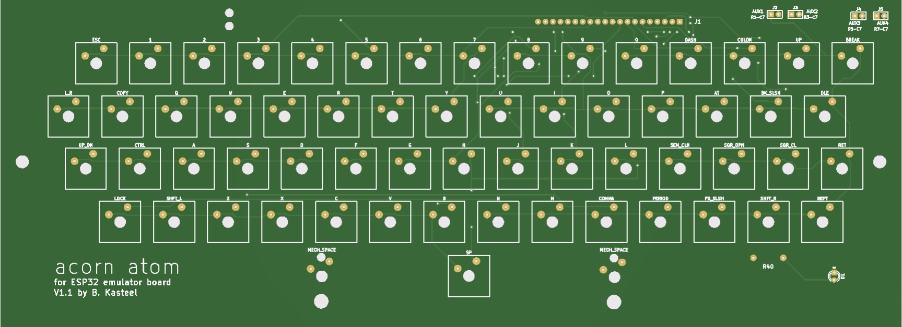<br>
<strong>MCP23017 keyboard wiring</strong>
</td>
<td align="center" width="50%">
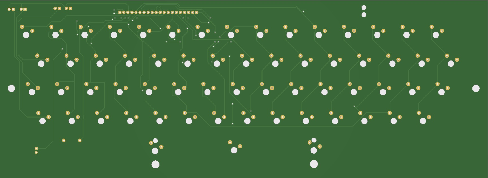<br>
<strong>MCP23017 fitted to the keyboard</strong>
</td>
</tr>
</table>

<table>
<tr>
<td align="center" width="50%">
<br>
<strong>MCP23017 connection to 8x8 keyboard</strong>
</td>
</tr>
</table>

<table>
<tr>
<td align="center" width="50%">
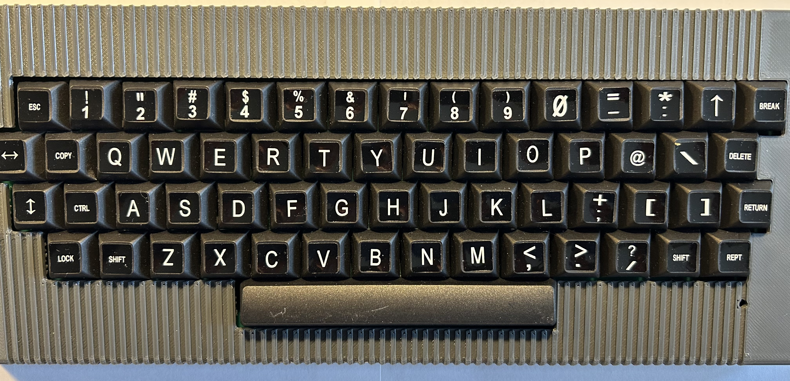<br>
<strong>Final 8x8 keyboard in its housing</strong>
</td>
<td align="center" width="50%">
<br>
<strong>Connection to 8048S070</strong>
</td>
</tr>
</table>

2. The reworked Acorn Atom keyboard from Hackjunk:
https://hackjunk.com/2025/03/24/acorn-atom-reworked/ . This PCB can be ordered
from his site. Shipped to the Netherlands it was about 43Euro.
It requires a little adaptation because the MCP23017 does not
simply solder directly into the original board. The following photographs show
how I connected the interface. MCP23017 adress is 0x21. 
The image was before making the mod from 0x20 to 0x21.


<table>
<tr>
<td align="center" width="30%">
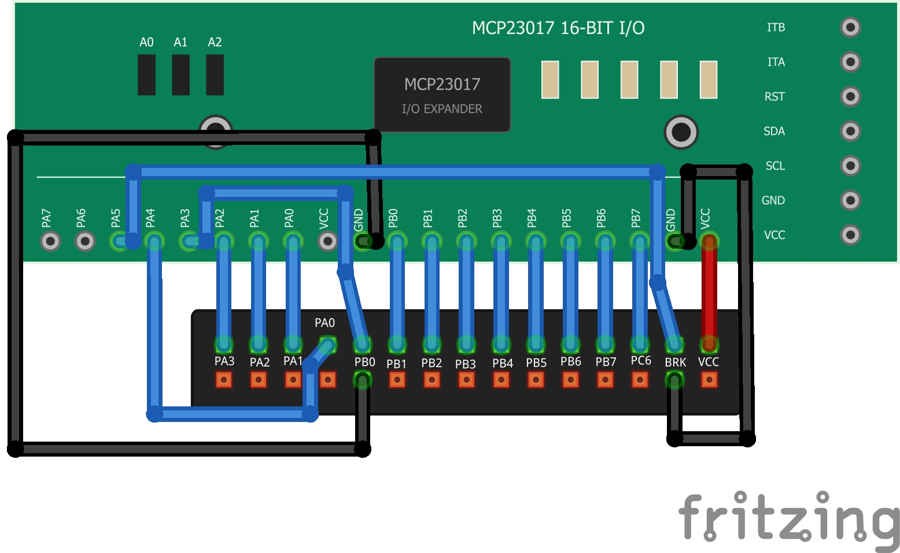<br>
<strong>MCP23017 keyboard wiring</strong>
</td>
<td align="center" width="30%">
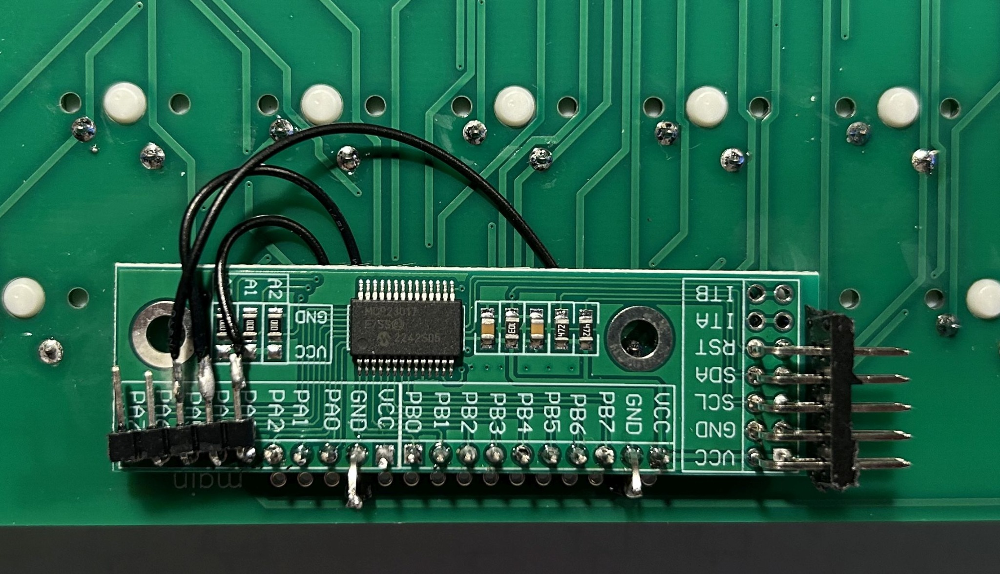<br>
<strong>MCP23017 fitted to the keyboard</strong>
</td>
<td align="center" width="30%">
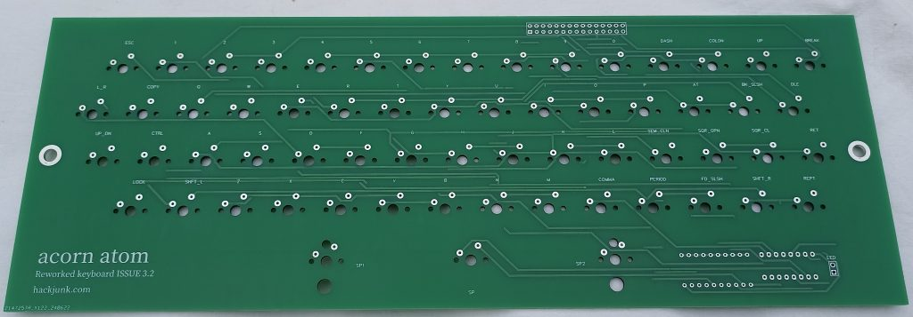<br>
<strong>Hackjunk reworked Acorn Atom keyboard PCB without components</strong>
</td>
</tr>
</table>

3. A 4 button keyboard with CTRL, SHIFT, REPT and BREAK buttons and this also has the AUX1 connected.
These buttons are often needed in ACORN Games and cannot be driven from a regular keyboard via
a terminal program such as Tara Term.
A regular keyboard does not transmit CTRL or SHIFT when only those keys are pressed.
MCP23017 adress is 0x22.

The adresses are used to identify the keyboard type in the software. So you need to solder
the A2 A1 and A0 jumpers correctly on the MCP23017. They are set to 0x20 by default.
The additional photograph below shows the Hackjunk keyboard PCB without components and is a useful
reference for the physical layout.

### MCP23017 keyboard identification (V191)

The firmware identifies the connected keyboard by its MCP23017 I²C address at startup. The address must match the physical keyboard layout; otherwise modifier keys can be interpreted incorrectly.

| Keyboard | MCP23017 address | A2 | A1 | A0 |
|---|---|---|---|---|
| New direct 8×8 | `0x20` | GND | GND | GND |
| Original Hackjunk | `0x21` | GND | GND | 3.3 V |
| Small auxiliary | `0x22` | GND | 3.3 V | GND |

**I²C wiring:** 8048S070 ESP32-S3: SDA GPIO19, SCL GPIO20 with 3.3 V logic.


### Keyboard housing

A dedicated 3D-printable enclosure has been developed for the physical Atom
keyboard. It follows the proportions and appearance of the original keyboard
while accommodating the reproduction PCB and MCP23017 interface. The design
uses a separate cover and base, 2.4 mm walls, PCB mounting pillars, angled
screw turrets with countersunk screw recesses, a rear cable opening and an
LED opening aligned with the keyboard PCB. The keyboard uses a 6.25U
spacebar stabilizer. The enclosure has been test-fitted with the keyboard PCB
and is intended for printing in PLA.

The production STL files are included with this README as
[Atom keyboard V097 PRODUCTION COVER.stl](keyboard/Atom_keyboard_V097_PRODUCTION_COVER.stl) and
[Atom keyboard_V097 PRODUCTION BASE.stl](keyboard/Atom_keyboard_V097_PRODUCTION_BASE.stl).

The current interface maps the matrix to MCP23017 GPIOs and scans it in a low-priority
task on ESP32-S3 Core 0.
This version retains the proven held-key behaviour while using the faster true-release
software-I2C implementation. Short physical key taps are also retained as a one-shot 
event for an external `$FE71` call for up to 750 ms. This prevents a brief real keypress 
from disappearing between two calls to the Kernel keyboard scanner. Serial input keeps its 
existing FIFO/FE71 latch, while direct/raw matrix readers still see only the genuine
current physical key state. This generic change restored responsive physical and
serial control in original software such as Frogger without any game-specific
patch or timing change.

Original Atom software does not use the keyboard in only one way, so the
emulator supports several access paths. Normal BASIC/ROM input uses the
keyboard FIFO; games that directly scan the 8255 see a held physical-key
matrix; and software calling the Kernel scanner at `$FE71` has a separate
discrete-key path. This is important for compatibility with original games.
The V097 keyboard housing is designed around the new 8×8 keyboard PCB.

Although the original Hackjunk keyboard has a similar layout, its key positions differ 
horizontally by approximately 3 mm. (Yes i got the design wrong) 
To fit the Hackjunk PCB into the V097 housing you need to do the following.

Drill new PCB mounting holes 3mm to the left of the existing mounting holes.
Carefully file away portions of the PCB edge to provide clearance around the cover fixing pillars.
**Important: The Hackjunk PCB is not a direct drop-in replacement.**
for the new 8×8 PCB in the V097 housing.
The new 8×8 PCB fits the V097 housing WITHOUT these modifications.

There are support pillars built into the housing base. You can fit threaded inserts into the holes in the base.
These are M3x5.7 from Ruthex. [Ruthex M3 x 5.7 Threaded inserts](https://www.ruthex.de/en/products/ruthex-gewindeeinsatz-m3-100-stuck-rx-m3x5-7-messing-gewindebuchsen?_pos=1&_sid=cea754fb1&_ss=r). 
<table>
<tr>
<td align="left" width="25%">
<br>
<strong>M3 threaded inserts</strong>
</td>
<td align="left" width="25%">
<br>
<strong>M3 thread placed</strong>
</td>
<td align="left" width="25%">
<br>
<strong>M3 thread solder</strong>
</td>
<td align="left" width="25%">
<br>
<strong>M3 thread final</strong>
</td>
</tr>
</table>
These can be melted into the PLA of the base by holding the tip of a soldering iron to the top
of the insert and guiding the inserts down into place. A 10mm bolt can then be used to secure the PCB.
I used an additional washer and nut just to raise the bolt so it fits into the insert.
Similarly the COVER can be held in place by M3 x 10mm at the front and M3 x 25mm bolts at the rear.

### BREAK and SHIFT+BREAK

The physical **BREAK** key performs an Atom reset and clears transient
keyboard/tape state before the normal Atom startup sequence. ASBK-S V24 is
then restored at the appropriate point in the Kernel startup.

**SHIFT+BREAK** selects the BBC BASIC environment. The Atom performs its
normal reset first, ASBK-S initialization is bypassed for this boot, and the
emulator enters BBC BASIC through the equivalent of `LINK #4000`. The command
is injected one character per genuine OSRDCH request because this proved to
be the reliable method with the original ROM timing. On entry the display is
cleared and the Atom cursor state is homed so BBC BASIC starts at the top of
the screen.

------------------------------------------------------------------------

## Cassette and `.atm` support

The emulator also retains its cassette-oriented storage support.

The default software directory is:

``` text
/ATOM/TAPES
```

ATM metadata includes:

-   Atom filename
-   load address
-   execution address
-   data length
-   program data

The emulator can construct the Atom cassette block stream, including
headers and checksums. Turbo paths accelerate common `LOAD` and `SAVE`
operations while retaining the Atom-visible semantics expected by the
original ROM.
This cassette path remains useful independently of AtoMMC2.

------------------------------------------------------------------------

## Audio

### The Atom sound source

The Atom has no dedicated sound synthesizer. Its speaker is controlled
by **8255 Port C bit 2 (PC2)**.
Original software creates sound by changing PC2 itself. The timing and
pattern of those transitions are therefore part of the original program.

The emulator follows the same principle:

``` text
original 6502 program
        |
    writes PC2
        |
   emulated 8255
        |
 timestamped PC2 edges
        |
 audio reconstruction
        |
    speaker output
```

There are no prerecorded effects and no game-specific sound tables.

### 8048S070 audio: continuous 6502-cycle timeline
The 8048S070 uses its **MAX98357 I2S amplifier**. The current sound
renderer records each PC2 transition with its **absolute emulated 6502
cycle number**. The audio task maintains a continuous 6502-time cursor
and reconstructs the resulting waveform at **80 kHz**. This is important
because Atom software can toggle PC2 very rapidly. The audio renderer
therefore follows the timing generated by the original 6502 code instead
of generating a synthetic sound whenever PC2 changes. A simple
AC-coupling/high-pass model adapts the digital PC2 waveform to a
loudspeaker-like signal before sending it to I2S. This generic method
has successfully reproduced distinct original effects such as:

-   alien marching
-   firing
-   different destruction sounds
-   continuous effects
-   player/turret effects

The exact timbre is not expected to be electrically identical to a
forty-year-old Atom speaker circuit, but the **source waveform and
timing come from the original Atom program**.

------------------------------------------------------------------------

## BASIC `RND` cold-start behaviour

Atom BASIC stores its five-byte random-number state at:

``` text
$0008-$000C
```

Clearing all emulated RAM to zero at startup left these bytes in an
all-zero state from which the original BASIC random-number algorithm
could not recover. A real Atom does not guarantee zero-filled RAM at
power-up. The emulator therefore initializes these five bytes to a
deterministic non-zero state:

``` text
78 56 34 12 90
```

After that, the **original BASIC ROM** advances the random-number
generator normally. No replacement `RND` implementation is used. This is
another example of the project's design rule: fix the emulated machine
state rather than patch the application.

------------------------------------------------------------------------

## Serial diagnostics and Atom output mirror
V191 keeps routine serial output relatively quiet while retaining
switches for diagnostics at the top of the main sketch:

``` cpp
#define SERIAL_SHOW_ATOMMC_COMMENTS      0
#define SERIAL_SHOW_CPU_DIAGNOSTIC       0
#define SERIAL_SHOW_RX_MATRIX_DIAGNOSTIC 0
```

Set a switch to `1` when that diagnostic is needed.
A separate Atom-visible control mirrors genuine Atom screen output to
the ESP32 serial port:

``` basic
?#BFFE=1
```

turns the mirror on, and:

``` basic
?#BFFE=0
```

turns it off. The mirror uses the original character/control stream
before MC6847 screen-code conversion, so it is useful for assembler
listings and diagnostics without replacing the Atom's own output
routines.

------------------------------------------------------------------------

## Screenshots
The emulator can save the current display as an uncompressed **24-bit
BMP** on the SD card.

Screenshots are stored under:

``` text
/ATOM/SCREENSHOTS
```

with automatically generated filenames such as:

``` text
ATOM0001.BMP
ATOM0002.BMP
```

------------------------------------------------------------------------

## Examples of programs running on the emulator
The following are direct screenshots captured from the emulated Atom display.
They illustrate several different types of software running on V191: games,
utility ROM software, graphics, and the normal Atom environment.

<table>
<tr>
<td align="center" width="50%">
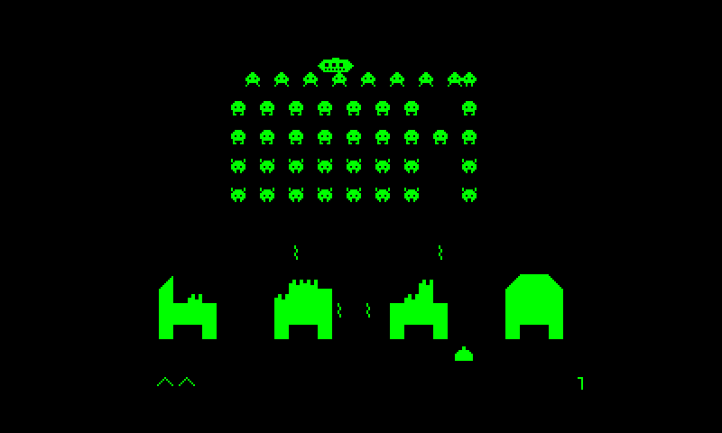<br>
<strong>Program example</strong> — Invaders running as 6502 code.
</td>
<td align="center" width="50%">
<br>
<strong>Program example</strong> — Asteroids original Atom program using the emulated display.
</td>
</tr>
<tr>
<td align="center" width="50%">
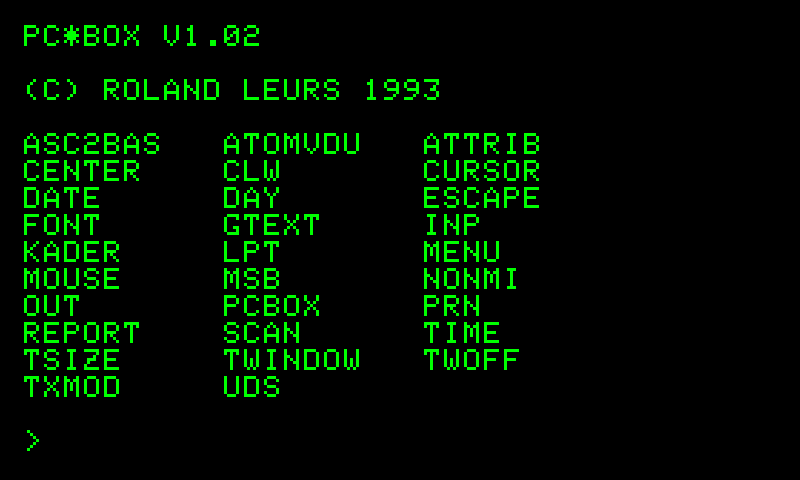<br>
<strong>Utility ROM software</strong> — PCBOX banked utilities available at $A000.
</td>
<td align="center" width="50%">
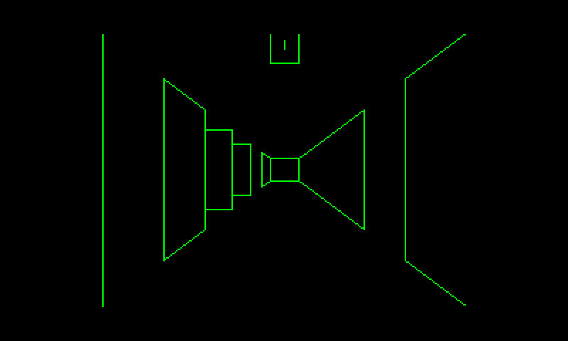<br>
<strong>Graphics example</strong> — Minotaur with its Atom graphics rendered by the MC6847 emulation.
</td>
</tr>
<tr>
<td align="center" width="50%">
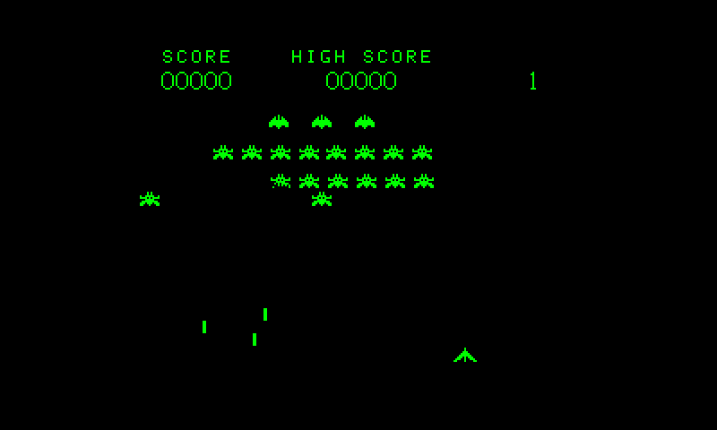<br>
<strong>Program example</strong> — Galaxian original Atom program.
</td>
<td align="center" width="50%">
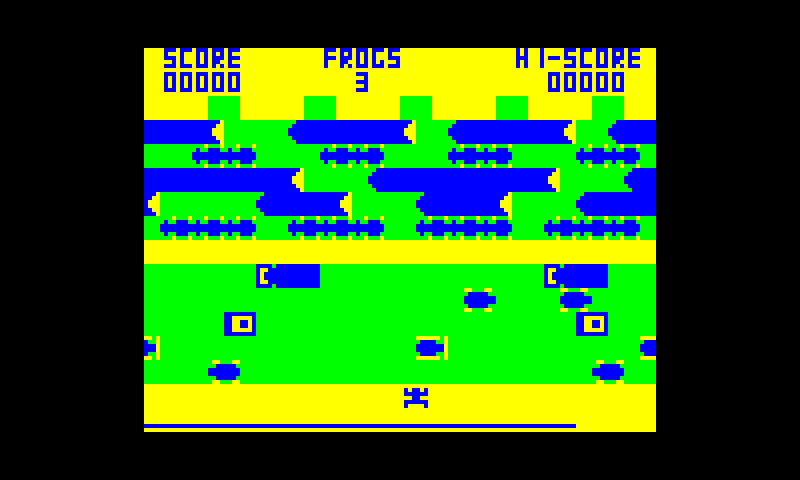<br>
<strong>Program example</strong> — Frogger original color Atom program.
</td>
</tr>
</table>


## SD-card layout
A typical SD card can contain:
``` text
/ATOM
+-- TAPES
|   +-- FROGGER.atm
|   +-- REVERSI.atm
|   +-- BREAKOUT.atm
|   +-- Games01
|   |   +-- ...
|   |   `-- ...
|   `-- ...
`-- SCREENSHOTS
    +-- ATOM0001.BMP
    `-- ...
```
AtoMMC2 can navigate the SD-backed filesystem directly, while the
original cassette/ATM interface remains available.
------------------------------------------------------------------------

## Building the Acorn Atom+

The project can be assembled around either the **ESP32-S3 8048S070** (the main 7-inch display version) or the **JC2432W328C CYD** (the alternative display version). The reproduction Atom keyboard is optional but gives the machine its original feel. The KiCad PCB and Gerber files are provided in [`keyboard/Acorn_Atom_Kicad_Production.zip`](keyboard/Acorn_Atom_Kicad_Production.zip), and the printable keyboard housing is included in the `keyboard/` directory.
You can send the gerbers to a PCB manufacturer eg the one in the link below. I still have some PCB's so please ask.

### Parts and suppliers

**Affiliate disclosure:** Some of the links below are affiliate links. I may earn a commission if you purchase through them, at no additional cost to you.

| Part | Purpose | Purchase / order link |
|---|---|---|
| 8048S070 | The main processor and screen to create the Acorn Atom+ | [Amazon - 8048S070](https://amzn.to/4B2mxSs) |
| Keycaps | Keycaps for the reproduction Atom keyboard; check the required layout and key sizes | [Amazon – keycaps](https://amzn.to/4d5deqB) |
| MX2-compatible mechanical switches | Keyboard switches; order enough for the populated PCB | [Amazon – MX2 switches](https://amzn.to/3TPVARc) |
| 6.25U space-bar stabilizer | Stabilizes the long space bar; check mounting compatibility | [Amazon – 6.25U stabilizer](https://amzn.to/4yw0Dpj) |
| Reproduction keyboard PCB | Manufacture using the supplied KiCad/Gerber production files | [JLCPCB – order PCB](https://jlcpcb.com/?from=PXESIOHETFUFRWPZXNY) |
| MCP23017 | Makes expansion of an I2C adress to 16 lines to connect to the keyboard |  [Amazon – MCP23017](https://link.amazon/B01JoZ3E9) |
| JC2432W328C CYD board | Display/controller for the alternative CYD firmware | [Amazon – JC2432W328C](https://amzn.to/4htEMYh) |


You will also need the **ESP32-S3 8048S070 board** if building the main 7-inch version, an **MCP23017 keyboard interface** as shown in the keyboard photographs, appropriate connectors/wires, and the parts needed to assemble the PCB and housing. Purchase links for these additional items have not yet been added. Check the board revision and connector pinout before applying power.

### Assembly overview

1. Order the keyboard PCB using the production Gerbers in the `keyboard/` folder, or use an existing compatible Atom keyboard.
2. Fit the MX-compatible switches, keycaps, 6.25U space-bar stabilizer and the required keyboard interface components.
3. Print the supplied keyboard base and cover if using the reproduction housing.
4. Connect the MCP23017 interface to the chosen ESP32 display board using the wiring instructions for **that specific board**. Both versions use 3.3 V logic; do not connect the keyboard VCC to 5 V.
5. Build and upload the corresponding V191 Arduino sketch. Prepare the required ROM images locally using the ROM preparation instructions elsewhere in this README.

## Software Building
The project uses the **Arduino ESP32 core** and **LovyanGFX** by Lovyan03/tobozo (tested with V1.2.27). It also uses the ESP32 I2S facilities for the MAX98357 audio output. Serial diagnostics use:
``` text
115200 baud
```
ROM images should be installed in SPIFFS using the filenames expected by
the sketch. V191 also requires the resident Schakelsoft image:
``` text
ASBK-S_v24.bin
```
Some of the ROM binaries are not supplied with the project, follow
**Preparing the V191 ROM `data` directory** below. The supplied Python
preparation utility identifies downloaded Atom ROMs by checksum, handles
the supported historical archive formats and builds a verified
`data_ready` directory. The resulting V191 `data` directory must be
uploaded to SPIFFS after changes to either the ROM set or the ASBK-S
binary.
------------------------------------------------------------------------


## Preparing the V191 ROM `data` directory
V191 uses original Acorn Atom and third-party ROM software. To make
installation straightforward, V191 includes the Python utility:
``` text
prepare_atom_roms_FINAL_v12.py
```
The utility identifies ROMs by their **historical Acorn Atom ROM
checksum**, not by filename. This is important because the same ROM is
often found under different filenames and in several old Atom
archive/container formats.

### Download sources
In the directory named `Roms` download the source files or
archives below into it. There is normally no need to rename, strip, or manually
extract the ROMs before running the preparation utility.

#### Atomulator ROMs
Download the Atomulator master archive:  
[https://github.com/hoglet67/Atomulator/archive/refs/heads/master.zip](https://github.com/hoglet67/Atomulator/archive/refs/heads/master.zip)  
This archive includes the BASIC, Floating Point and Kernel ROMs. The preparation program will find the required ROMs automatically.

| V191 file | Atom checksum | Source |
| --- | --- | --- |
| `Atom_Basic.rom` | `D67D` | Atomulator `roms` directory |
| `Atom_FloatingPoint.rom` | `AAA1` | Atomulator `roms` directory |
| `Atom_Kernel.rom` | `F0B9` | Atomulator Kernel, automatically patched for AtoMMC2 |


#### Wouter Ras Atom ROM collection
Download `atom.zip`:
https://www.stairwaytohell.com/atom/wouterras/atom.zip
This archive contains several of the required ROMs, including P-Charme,
SALFAA, GAGS and AXR-1. The preparation program will locate and convert the
required images automatically.
| V191 file | Atom checksum | Source |
| --- | --- | --- |
| `Atom_pcharme.rom` | `72FD` | by Frans van Hoesel : `atom.zip`, in `ExtROM.Tap` |
| `SALFAA_2.6.rom` | `3626` | by  B.Poot and later expanded by J.Jobse : `atom.zip`; archive image `9F75` is converted automatically |
| `GAGS_2.3.rom` | `19C1` | by Gerrit Hillebrandt : `atom.zip`; archive image `196E` is normalised automatically |
| `AXR-1.rom` | `CCEB` |by Jos Horsmeijer : `atom.zip`, in `ExtROM.Tap` |

#### DISATOM
Download `disatom`:
https://www.acornatom.nl/atomarch/acl1-31/disatom
| V191 file | Atom checksum | Source |
| --- | --- | --- |
| `DISATOM.rom` | `7049` | by J.R. Stevenson & J.C. Rocket : Acorn Atom archive `acl1-31` |

#### PCBOX
Download `pcbox.rom`:
https://www.acornatom.nl/atomarch/atominpc.108/pcbox.rom
| V191 file | Atom checksum | Source |
| --- | --- | --- |
| `PCBOX_v1.02.rom` | `41CE` | by Roland Leurs : Atom-in-PC 1.08 archive |

#### TOOLBUG
Download `toolbug`:
https://www.acornatom.nl/atomarch/acl2-05/toolbug
| V191 file | Atom checksum | Source |
| --- | --- | --- |
| `TOOLBUG.rom` | `129F` | by Company: Psion : Acorn Atom archive `acl2-05` |

#### BBC Basic
Download `ATBASIC3`:
https://mdfs.net/Software/BBCBasic/Atom/ATBASIC3
| V191 file | Atom checksum | Source |
| --- | --- | --- |
| `ATBASIC3` | `16kb` | BBC BASIC for Acorn Atom — MDFS (J. G. Harston) |
| checksum (SHA256) = a7310823149731872e326dbe6a0d56769e0435390465bc872b2e4e9aa0c05c73 |


#### Project-supplied ROMs
The ASBK images are already supplied with the V191 project and do not need to
be downloaded separately.
| V191 file | Atom checksum | Source |
| --- | --- | --- |
| `ASBK-I_v1.03.rom` | `988C` | by Aren Slootweg and Bas Kasteel : Project-supplied V1.03 image |
| `ASBK-S_v24.bin` | `57CD` | by Aren Slootweg and Bas Kasteel : Project-supplied V24 image, exactly 1633 bytes |
| `ATMMC3E.rom` | `5072` | by David Banks : AtoMMC v3.02, **PIC / E000** build |
For AtoMMC2, we use the **v3.02 PIC E000** ROM. 
Do not substitute the AVR `ATMMC3E.rom` from the same release. It is a
different binary. AtoMMC v3.00 introduced separate AVR/PIC and A000/E000
builds together with 1/2/4 MHz support; v3.02 is the release used by V191.
This rom is included by kind permission of David Banks.

### Run the preparation utility
Put [`prepare_atom_roms_FINAL_v12.py`](Roms/prepare_atom_roms_FINAL_v12.py) in the `Roms` directory with the
downloaded files and archives, then run:
``` text
python prepare_atom_roms_FINAL_v12.py
```
The program scans the directory recursively. It understands the formats
encountered in the historical Atom archives, including: - ordinary
4096-byte ROM images; - 16 KiB CDEF ROM collections; - ZIP archives; -
multi-ROM `.Tap` files such as `ExtROM.Tap`; - 4112- and 4118-byte
Atom-PC wrappers; - 4351-byte Atom archive files.
It creates:
``` text
Roms/
`-- data_ready/
```
Do **not** choose ROMs merely because their filenames look correct. The
preparation program checks the actual binary contents.

### Acorn Atom checksum
The preparation utility uses the historical **Acorn Atom ROM checksum /
signature** used for identifying Atom ROM images. It deliberately does
not depend on CRC32, MD5, SHA-1 or SHA-256 for ROM identification.
Useful reference values are:
``` text
D67D  original Acorn Atom BASIC
AAA1  original Acorn Atom Floating Point
E386  original Acorn Atom Kernel
```
The V191 Kernel is intentionally different from the original Kernel
because of the AtoMMC2 E000 integration. Its final required checksum is
`F0B9`.
The utility first removes a recognised archive/header format where
necessary and calculates the Atom checksum on the actual ROM payload. It
then:

1.  identifies known ROM versions by checksum;
2.  performs only conversions that have been explicitly verified for
    V191;
3.  gives the resulting file the filename expected by the emulator;
4.  writes it to `data_ready`;
5.  checks the complete V191 set again.

For example, the Wouter Ras `ExtROM.Tap` contains archive variants of
GAGS and SALFAA. They are recognised by their own checksums and
converted to the exact images required by V191:
``` text
GAGS 2.3
196E -> 19C1 -> GAGS_2.3.rom
SALFAA 2.6
9F75 -> 3626 -> SALFAA_2.6.rom
```
Unknown ROMs are reported but are not silently substituted for a
required V191 ROM.

### Required final set
A successful preparation must report all **14/14** files as `OK`:
``` text
D67D  Atom_Basic.rom
AAA1  Atom_FloatingPoint.rom
F0B9  Atom_Kernel.rom
72FD  Atom_pcharme.rom
7049  DISATOM.rom
3626  SALFAA_2.6.rom
19C1  GAGS_2.3.rom
41CE  PCBOX_v1.02.rom
129F  TOOLBUG.rom
CCEB  AXR-1.rom
5072  ATMMC3E.rom                       (project-supplied)
57CD  ASBK-S_v24.bin       1633 bytes   (project-supplied V24 image)
988C  ASBK-I_v1.03.rom                  (project-supplied)
ATBASIC3 (SHA256)     a7310823149731872e326dbe6a0d56769e0435390465bc872b2e4e9aa0c05c73
```
The end of the report should therefore say:
``` text
RESULT: COMPLETE
```
If an entry is marked `X`, obtain the missing/correct source ROM and run
the utility again. Do not copy an unknown ROM into `data_ready` simply
to satisfy the filename.

### Install the prepared files
Once the report shows all 14 entries as `OK`, copy the contents of
`data_ready` into the Arduino project's `data` directory. That `data`
directory is then uploaded to the ESP32 SPIFFS filesystem using the
normal filesystem upload procedure for the selected Arduino/ESP32
environment. The resulting SPIFFS data set supplies the four system
ROMs, eight banked utility ROMs and resident ASBK-S binary required by
V191.

------------------------------------------------------------------------

## Getting started
After a successful boot the display should show:
``` text
ACORN ATOM+

>
```
Schakelsoft is already resident and initialized at this point.
Utility-ROM commands can be entered immediately; no ASBK-S `*EXEC` or
manual `LINK #1005` is required.
AtoMMC2 can then be used directly:
``` text
*CAT
```
Navigate into a directory:
``` text
*CWD Games01
*CAT
```
Load and run software:
``` text
*LOAD FROGGER
*RUN FROGGER
```
or use the Atom's traditional BASIC/cassette commands where appropriate:
``` basic
LOAD "FROGGER"
RUN
```
------------------------------------------------------------------------

## V191 stable milestone

V191 is the current known-good milestone. It retains the proven PIC ATMMC3E
AtoMMC2 environment, resident ASBK-S V24, eight banked `$A000` utility ROMs,
BBC BASIC SHIFT+BREAK boot and the keyboard baseline. The additional
V191 keyboard work adds a generic one-shot physical-key event latch for external
`$FE71` calls. Diagnostic testing showed that some original software polls FE71
infrequently enough for a short physical press to begin and end between calls;
serial input did not lose the same press because it remained queued in the FIFO.
V191 gives physical FE71 input the same discrete-event reliability while leaving
normal held-key and raw-matrix semantics unchanged. Both physical keyboard and
serial control were then verified working correctly with the original Frogger
program, with no Frogger-specific modification.
Confirmed functionality includes:
-   Atom boots to BASIC
-   original BASIC, Floating Point and Kernel ROM execution
-   regulated \~1 MHz 6502 execution
-   normal BASIC keyboard input
-   raw matrix-scanning game controls
-   direct `FE71` keyboard users
-   BREAK handling
-   MC6847 text and graphics
-   monochrome and colour graphics
-   SD-card access
-   `.atm` cassette loading and saving
-   SD directory navigation
-   screenshots
-   eight-bank `$A000` utility-ROM system
-   ASBK-I v1.03 in utility-ROM bank 1
-   resident ASBK-S V24 at `$1000-$1660`
-   automatic ASBK-S initialization at `$1005` after RESET
-   circular Schakelsoft command routing across all eight utility-ROM
    banks
-   `ATMMC3E` at `$E000`
-   `ACORN ATOM+` startup
-   AtoMMC2 catalogue and directory navigation
-   AtoMMC2 load/run
-   AtoMMC2 save/write
-   delete and rename
-   directory create/remove
-   AtoMMC2 `*EXEC`, wildcard matching and absolute/relative path
    handling
-   continuous PC2/I2S sound on the 8048S070
-   BASIC `RND` cold-start correction

A substantial collection of original Atom software has been used during
development. Compatibility work remains focused on reproducing the
machine interface rather than recognizing individual applications.
------------------------------------------------------------------------

## Design philosophy
The recurring rule is:
> **Do not recognize a game and fake the result. Emulate the Atom
> mechanism the game expects.**
Examples:
-   graphics are selected from Atom/MC6847 state, not a game name;
-   sound comes from genuine timestamped PC2 transitions, not
    prerecorded effects;
-   CPU speed is regulated globally rather than adding timing hacks to
    individual programs;
-   `RND` was fixed by correcting cold-start machine state;
-   keyboard compatibility distinguishes the different ways real Atom
    software reads the keyboard;
-   AtoMMC2 runs its original `$E000` ROM against an emulated controller
    interface;
-   `$A000` banking exposes genuine utility ROM images rather than
    reimplementing their commands;
-   `.atm` handling preserves Atom filenames, addresses and program
    data.
This allows one correction to improve many programs.
------------------------------------------------------------------------

## Alternative hardware: JC2432W328C CYD

The repository also includes **`ATOM_6502_CYD_V191`**, a CYD-specific version of the Atom emulator. The emulated Atom software and keyboard concept are shared with the 8048S070 version, but the display hardware, keyboard GPIO assignments and audio output are different. Use the CYD sketch for this board rather than the 8048S070 sketch.

### Keyboard connection

The CYD V191 firmware uses the MCP23017 interface through **software I²C**:

| CYD V191 signal | GPIO | MCP23017 connection |
|---|---:|---|
| SDA | 21 | SDA |
| SCL | 22 | SCL |
| 3.3 V | — | VCC |
| Ground | — | GND |

<table>
<tr>
<td align="left" width="50%">
<br>
<strong>Connection to CYD</strong>
</td>
</tr>
</table>

The MCP23017 keyboard identification addresses remain the same as described in the main keyboard section. **Do not use the 8048S070 connector photograph as a wiring guide for the CYD.** Check the pinout of the particular JC2432W328C revision you have before connecting the keyboard.

### Sound output

The **8048S070** version sends digital audio to its onboard **MAX98357 I²S amplifier**. The **CYD V191** version instead uses **GPIO26** and the ESP32 LEDC peripheral, configured for **40 kHz, 8-bit PWM**. Its audio routine shapes the emulated Atom PC2 transitions with a short decay. Consequently, sound character and output hardware differ between the two builds.

The CYD audio connection must follow the actual CYD board's amplifier/speaker circuit; do not copy the 8048S070 I²S pin assignments. The correct speaker wiring depends on the exact board revision.

### Software and setup differences

- **8048S070:** use `ATOM_6502_8048S070_V191`; keyboard SDA GPIO19, SCL GPIO20; MAX98357 I²S sound.
- **CYD:** use `ATOM_6502_CYD_V191`; keyboard SDA GPIO21, SCL GPIO22; GPIO26 PWM sound.
- The CYD has its own display initialization and hardware configuration. Follow the CYD sketch's setup rather than the 7-inch board instructions.
------------------------------------------------------------------------


## Credits and acknowledgements

### Fake6502
**Fake6502 CPU emulator core v1.1 --- Mike Chambers, 2011** Fake6502 is
the 6502 execution engine used by this project. Its source is released
into the public domain and requests attribution. Many thanks to Mike
Chambers for making it available.

### AtoMMC2
AtoMMC2 is the SD/MMC filing system originally developed for the Acorn
Atom by **Charlie Robson (SirMorris / EightyBits)**, with later work by
**Phill Harvey-Smith** and other Atom community contributors. This
emulator uses the original AtoMMC Atom-side ROM and emulates the
controller interface required by that ROM.

### ASBK / Schakelsoft
The ASBK-I and ASBK-S software originates from the historical Dutch
Acorn Atom community work by **Aren Slootweg and Bas Kasteel**. V191
uses ASBK-I v1.03 in bank 1 and a reconstructed ASBK-S source whose V24
circular-search and AtoMMC-vector extension allows commands from the
eight banked utility ROMs to be used in arbitrary order. The original
software and documentation retain their respective copyright status.

### Acorn Atom
The Acorn Atom hardware design, ROM software, BASIC and original
documentation are the work of Acorn and their respective
authors/rightsholders. Original ROMs and commercial software retain
their original copyrights.

### Display libraries
The ESP32-S3 8048S070 version uses **LovyanGFX**. Please retain and follow the licences of all third-party
libraries included in or required by your build environment.

### Community and preservation resources
Original Atom manuals, software archives, cassette images and community
research have been invaluable in understanding how real software uses
the machine. Third-party software and documentation retain their own
licences and copyrights.
------------------------------------------------------------------------

## Project status
**V191 is a stable development milestone**, not the end of the project.
The emulator now provides a standalone Atom environment on the 7-inch ESP32-S3 8048S070, capable of running
a substantial amount of original software while preserving the original
6502 execution, hardware interfaces and ROM behaviour. On the 8048S070,
V191 also boots directly into the enhanced `ACORN ATOM+` environment
with AtoMMC2, eight utility-ROM banks and resident Schakelsoft already
available.
Potential future work includes:

-   completing less commonly used AtoMMC2 functions
-   random-access AtoMMC2 file support
-   broader compatibility testing
-   additional Atom peripherals
-   continued compatibility testing for software using unusual keyboard access paths
-   Teletext mode with 40x24 VDU display
